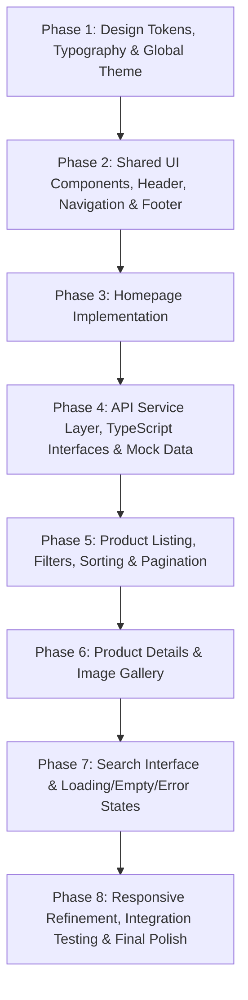

# PATRONET Frontend Design & Technical Specification

> **Google Stitch Inspection & Architectural Specification**
> **Project:** PATRONET – Retail Marketplace
> **Project ID:** `4674924834940117953`
> **Inspection Source:** Stitch Screens `dcda3d0f3163417db65c7b6343f2883a`, `0368e623686e41589ae0b172ec821226`, `58428ae3c104480db028d5f6468b369b`, `49d53b2552ff402ca1b13a92d30121b2`
> **Document Status:** Approved Direction with Strict API & Architectural Boundaries (Pre-Implementation Baseline)

---

## 1. Project Overview

PATRONET is an enterprise-scale, Pan-India unified retail marketplace frontend. The visual design system—extracted from Google Stitch—reflects a modern, trust-focused e-commerce marketplace featuring deep navy primary tones, saffron/amber accents, structured catalog browsing, faceted filter bars, and clear price presentation.

### Primary Screen Inventory from Google Stitch

| Screen Role | Stitch Screen ID | Screen Type | Canvas Dimensions | Device Target |
| :--- | :--- | :--- | :--- | :--- |
| **Homepage** | `dcda3d0f3163417db65c7b6343f2883a` | Design / HTML | 2560 × 7138 px | Desktop |
| **Product Listing (PLP)** | `0368e623686e41589ae0b172ec821226` | Design / HTML | 2560 × 5700 px | Desktop |
| **Product Details (PDP)** | `58428ae3c104480db028d5f6468b369b` | Design / HTML | 2560 × 4598 px | Desktop |
| **Search Results** | `49d53b2552ff402ca1b13a92d30121b2` | Design / HTML | 2560 × 3840 px | Desktop |

> [!NOTE]
> All Stitch designs represent desktop viewports. No separate mobile or tablet screens exist in Stitch. Responsive behavior is engineered via Tailwind breakpoints derived directly from the layout structure in the Stitch HTML.

---

## 2. Design System & Extracted Design Tokens

All tokens below are extracted verbatim from the Stitch screen code and mapped into the frontend project's existing Tailwind CSS v4 `@theme inline` configuration in `patronet-frontend/src/index.css`.

### 2.1 Brand & Material You Surface Palette

The color system adopts Google Material Design 3 (Material You) semantic tokens calibrated to PATRONET's navy brand identity with amber/saffron highlights:

```css
/* Stitch Extracted Color Tokens */
--color-primary: #042373;
--color-primary-container: #243b8a;
--color-on-primary: #ffffff;
--color-on-primary-container: #95a9ff;
--color-primary-fixed: #dce1ff;
--color-primary-fixed-dim: #b7c4ff;
--color-on-primary-fixed: #001552;
--color-on-primary-fixed-variant: #2a4190;
--color-inverse-primary: #b7c4ff;

--color-secondary: #a04100;
--color-secondary-container: #fe6b00;
--color-on-secondary: #ffffff;
--color-on-secondary-container: #572000;
--color-secondary-fixed: #ffdbcc;
--color-secondary-fixed-dim: #ffb693;
--color-on-secondary-fixed: #351000;
--color-on-secondary-fixed-variant: #7a3000;

--color-tertiary: #232b3f;
--color-tertiary-container: #394156;
--color-on-tertiary: #ffffff;
--color-on-tertiary-container: #a5adc6;
--color-tertiary-fixed: #dae2fd;
--color-tertiary-fixed-dim: #bec6e0;
--color-on-tertiary-fixed: #131b2e;
--color-on-tertiary-fixed-variant: #3f465c;

--color-background: #f8f9fb;
--color-on-background: #191c1e;
--color-surface: #f8f9fb;
--color-on-surface: #191c1e;
--color-surface-variant: #e0e3e5;
--color-on-surface-variant: #444651;
--color-surface-dim: #d8dadc;
--color-surface-bright: #f8f9fb;
--color-surface-container-lowest: #ffffff;
--color-surface-container-low: #f2f4f6;
--color-surface-container: #eceef0;
--color-surface-container-high: #e6e8ea;
--color-surface-container-highest: #e0e3e5;
--color-inverse-surface: #2d3133;
--color-inverse-on-surface: #eff1f3;
--color-surface-tint: #4459a9;

--color-outline: #757682;
--color-outline-variant: #c5c5d3;

--color-error: #ba1a1a;
--color-error-container: #ffdad6;
--color-on-error: #ffffff;
--color-on-error-container: #93000a;
```

### 2.2 Typography Hierarchy

- **Font Family:** `Plus Jakarta Sans`, sans-serif (imported via Google Fonts `@import url('https://fonts.googleapis.com/css2?family=Plus+Jakarta+Sans:wght@400;500;600;700&display=swap');` in `index.css`).
- **Iconography Standard:** Strictly uses the already installed `lucide-react` package. No external Material Symbols font or dependency is introduced. (See Section 4.5 for icon mapping).
- **Type Scale Definitions:**

| Token | Size | Line Height | Letter Spacing | Weight | Usage |
| :--- | :--- | :--- | :--- | :--- | :--- |
| `display-lg` | 48px (3rem) | 56px | -0.02em | 700 | Hero banners, high-impact titles |
| `display-sm` | 36px (2.25rem) | 44px | -0.02em | 700 | Product title on PDP, major headings |
| `headline-lg` | 28px (1.75rem) | 36px | -0.015em | 600 | Page titles (PLP, Search results, Section headers) |
| `headline-lg-mobile` | 24px (1.5rem) | 32px | -0.01em | 600 | Responsive header fallback on mobile |
| `headline-sm` | 20px (1.25rem) | 28px | normal | 600 | Logo text, module subheadings, filter headers |
| `title-md` | 16px (1rem) | 24px | normal | 600 | Card titles, category card titles, dialog headers |
| `body-lg` | 16px (1rem) | 26px | normal | 400 | Long-form descriptions, editorial text |
| `body-md` | 14px (0.875rem) | 22px | normal | 400 | Standard body copy, inputs, table contents |
| `body-sm` | 12px (0.75rem) | 18px | normal | 400 | Captions, auxiliary metadata, timestamps |
| `label-md` | 13px (0.8125rem) | 16px | 0.01em | 600 | Button labels, pills, tabs, status badges |
| `label-sm` | 11px (0.6875rem) | 14px | 0.04em | 700 | Overlines, SKU tags, category uppercase labels |

### 2.3 Spacing & Layout Tokens

```json
{
  "spacing": {
    "space-xs": "0.25rem",     /* 4px */
    "space-sm": "0.5rem",      /* 8px */
    "space-md": "1.0rem",      /* 16px */
    "space-lg": "1.5rem",      /* 24px */
    "space-xl": "2.5rem",      /* 40px */
    "gutter-sm": "1.0rem",     /* 16px */
    "gutter": "1.5rem",        /* 24px */
    "gutter-lg": "2.0rem",     /* 32px */
    "margin-mobile": "1.0rem", /* 16px */
    "margin": "2.0rem"         /* 32px */
  }
}
```

### 2.4 Border Radii

```json
{
  "borderRadius": {
    "DEFAULT": "0.25rem",  /* 4px */
    "md": "0.375rem",      /* 6px */
    "lg": "0.5rem",        /* 8px (buttons, product thumbnails) */
    "xl": "0.75rem",       /* 12px (cards, aside navigation, banners) */
    "2xl": "1.0rem",       /* 16px (large containers, search boxes) */
    "3xl": "1.5rem",       /* 24px */
    "full": "9999px"       /* Pill buttons, search inputs, badges */
  }
}
```

### 2.5 Elevation & Box Shadows

- **Header / Sticky Bars:** `shadow-[0_1px_8px_rgba(0,0,0,0.04)]`
- **Surface Elevation XS:** `shadow-xs`
- **Card Default Elevation:** `shadow-sm`
- **Card Hover Elevation:** `hover:shadow-md`
- **Interactive Modals / Drawers:** `shadow-xl`

### 2.6 Header, Navigation, and Sidebar Geometry

- **Global Header Height:** Total height = 120px (80px Main Bar + 40px Sub-navigation Bar).
  - **Main Bar:** `h-20` (80px), `w-full max-w-7xl mx-auto px-gutter flex items-center justify-between gap-gutter`.
  - **Sub Bar:** `h-10` (40px), `bg-surface-container-low`, includes location indicator and category navigation links.
- **Sidebar Width:**
  - Homepage Aside: `w-full lg:w-64 flex-shrink-0` (256px).
  - PLP / Search Filters: `lg:col-span-3` of a 12-column grid (~280px - 320px depending on container width), sticky at `top-[136px]`.
- **Main Container Width:** `max-w-7xl` (1280px) centered with `mx-auto px-gutter` (24px side padding).

---

## 3. Screen-by-Screen Breakdown & Visual Adaptation

To retain visual structure while adhering strictly to available API data, unsupported visual fields in the Stitch design are omitted or handled cleanly without fabricating data.

### 3.1 Homepage (`dcda3d0f3163417db65c7b6343f2883a`)

- **Header Section:**
  - Two-tier sticky navigation with logo, global search bar, wishlist counter, cart counter, and user account trigger.
  - Sub-navigation bar with dynamic category links fetched from `GET /api/categories` and static delivery location display ("Deliver to: Mumbai 400001").
- **Hero & Dynamic Category Aside (12-Column Grid):**
  - **Left Column (`lg:col-span-4` / `w-64`):**
    - Dynamic category list populated strictly from `GET /api/categories` (no hardcoded category list or counts).
    - Promotional card for PATRONET Plus membership.
  - **Right Column (`lg:col-span-8`):**
    - Promotional banner carousel ("Next-Gen Living Essentials").
    - Four core value propositions: Pan-India Free Shipping, 7-Day Easy Returns, 100% Genuine Guaranteed, Verified Brand Sellers.
- **Popular Categories Section:**
  - Grid of category cards dynamically driven by `GET /api/categories`.
- **Featured Products Section:**
  - 4-column product grid populated via `GET /api/products?page=1&page_size=8`.
  - Retains product cards showing image, title, brand, SKU, and price. No star ratings or review counts are rendered.
- **Spotlight Banner Section:**
  - Featured showcase banner highlighting catalog flagship hardware.
- **Bank Discounts & Payment Offers Banner:**
  - Visual informational banner for partner bank discounts.
- **New Arrivals Grid & Newsletter Subscription:**
  - Catalog feed via `GET /api/products?sort=newest` and email capture form.
- **5-Column Marketplace Footer:**
  - Brand overview, About Patronet, Customer Support, Contact details (1800-PATRONET), and copyright information.

### 3.2 Product Listing Page (PLP) (`0368e623686e41589ae0b172ec821226`)

- **Header & Breadcrumbs:**
  - Hierarchy breadcrumbs (`Home > Category Name`).
  - Active filter chips with individual dismiss actions and a "Clear All" button.
- **Layout (12-Column Responsive Layout):**
  - **Filter Sidebar (`lg:col-span-3`):**
    - **Category Filter:** Dynamic radio list populated directly from `GET /api/categories` (`category_id` query parameter).
    - **Price Range Filter:** Dual numerical inputs (`min_price`, `max_price`) in Indian Rupees (₹).
    - **Brand Filter:** Multi-select checkbox facet sending `brand` query parameter.
    - *Omitted Filters:* Unsupported rating, seller, and availability filters from the Stitch mockup are removed from the functional scope.
  - **Product Catalog Area (`lg:col-span-9`):**
    - **Toolbar:** Result count display ("Showing X of Y products") and Sort dropdown supporting strictly:
      - `price_asc` (Price: Low to High)
      - `price_desc` (Price: High to Low)
      - `newest` (Newest Arrivals)
    - **Product Grid:** Responsive 3-to-4 column grid (`grid-cols-1 sm:grid-cols-2 md:grid-cols-3 xl:grid-cols-4`).
    - **Pagination:** Controlled pagination passing `page` and `page_size`.

### 3.3 Product Details Page (PDP) (`58428ae3c104480db028d5f6468b369b`)

- **Breadcrumbs:** `Home > Category > Product Name`.
- **Product Overview (12-Column Grid):**
  - **Gallery Column (`lg:col-span-6`):**
    - Viewport displaying active image from `product.images`.
    - Thumbnail row allowing user to select between real product images returned by `GET /api/products/{product_id}`.
  - **Purchase Column (`lg:col-span-6`):**
    - Brand name and Product title (`font-display-sm font-bold`).
    - **No Ratings or Review Counts:** Stitch mockup displayed star ratings and review counts; these are omitted entirely.
    - Price display in Indian Rupees (`₹XX,XXX`) with "Inclusive of all taxes" label.
    - **No Fabricated Product Variants:** Single-SKU presentation. No artificial color or size selectors.
    - **No Fabricated Stock Availability:** Stock status text ("In Stock - Ships Tomorrow") is omitted; only actual availability rules from the API are respected.
    - Quantity selector (`-`, input, `+`).
    - Actions: `Add to Cart` and `Buy Now` buttons.
    - **Pincode UI Component:** Input field allowing user interaction; displays standard shipping policy text ("Pan-India delivery available") without fabricating delivery dates or availability checks.
    - Trust badges: 100% Genuine, 7-Day Replacement, Free Shipping, 1-Year Brand Warranty.
- **Product Information Tabs:**
  - Retains visual tab structure (`Description`, `Details`).
  - Displays actual available `product.description` and SKU metadata.
  - Does not invent technical specification tables (e.g. driver size, frequency range, battery life) absent from the backend response.
- **Related Products Section:**
  - Product grid fetching related items via `GET /api/products?category_id={product.category_id}&page_size=4`.

### 3.4 Search Results Page (`49d53b2552ff402ca1b13a92d30121b2`)

- **Search Query Banner:**
  - Query header displaying the current search term.
- **Architecture Strategy for Search:**
  - **Mock Search Service Layer:** The existing backend API does not support search query parameters. The UI uses separate mock search data initially (`src/mocks/search.mock.ts` and `src/services/search.service.ts`).
  - **No Client-Side Search Substitute:** The frontend will **not** implement client-side search over the catalog as a replacement for OpenSearch.
  - **No Unapproved Parameters:** The frontend will **not** send unapproved search parameters (`q`, `search`) to `GET /api/products`.
  - **Documented OpenSearch Integration Point:** The `search.service.ts` interface defines `searchProducts(query: string, params: SearchParams): Promise<ProductListResponse>` ready for seamless switchover to the backend OpenSearch service once exposed.
- **Explicit UI States (from Stitch Design):**
  - **Success / Active Results:** Grid showing matched product cards.
  - **Empty Results State:** Centered graphic with "No products found for [query]" and a "Clear Search" CTA.
  - **Loading Skeleton State:** Animated pulse (`animate-pulse`) skeleton grid with 8 cards.
  - **Error Gateway State:** Error container indicating inability to reach search gateway with a "Try Again" button.

---

## 4. Component Inventory & Architecture

### 4.1 Architecture & Separation of Concerns

```
patronet-frontend/src/
├── types/             # Strict TypeScript definitions matching API responses exactly
│   ├── product.types.ts
│   ├── category.types.ts
│   └── search.types.ts
├── services/          # Pure API service layer using VITE_API_BASE_URL (no UI logic)
│   ├── api.client.ts  # Base HTTP fetch wrapper with baseURL from env
│   ├── product.service.ts
│   ├── category.service.ts
│   └── search.service.ts # Mock initially; clean OpenSearch integration hook
├── mocks/             # Isolated mock data for offline/unsupported contracts
│   └── search.mock.ts # Realistic search results mock
├── hooks/             # Data-fetching hooks (react state/effects)
│   ├── useProducts.ts
│   ├── useProductDetail.ts
│   ├── useCategories.ts
│   └── useSearch.ts
├── components/
│   ├── layout/        # AppHeader, AppFooter, PageContainer, SubNav
│   ├── products/      # ProductCard, ProductGrid, ProductGallery, PriceBlock
│   ├── search/        # GlobalSearchBar, FilterSidebar, SearchStates
│   └── ui/            # Base UI / shadcn primitives (Button, Input, Checkbox, Tabs)
└── pages/             # Page views orchestrating hooks and components
    ├── HomePage.tsx
    ├── ProductListingPage.tsx
    ├── ProductDetailPage.tsx
    └── SearchResultsPage.tsx
```

### 4.2 Component Breakdown

#### Layout Components
- `AppHeader`: Fixed two-tier navigation.
- `CategorySubNav`: Dynamic horizontal category ribbon powered strictly by `GET /api/categories`.
- `AppFooter`: 5-column footer with contact and legal links.
- `PageContainer`: `max-w-7xl mx-auto px-gutter`.

#### Product Components
- `ProductCard`:
  - Square product image with hover scale (`aspect-square bg-surface-container-low group-hover:scale-105`).
  - Brand name (uppercase `font-label-sm`) + Category name.
  - 2-line clamped product title (`font-title-md line-clamp-2`).
  - SKU metadata (`PAT-ELEC-XXXX`).
  - Price in INR (`font-headline-sm font-bold text-primary`).
  - **No ratings badge, no stock claim.**
  - Action buttons: `View Details` and `Add`.
- `ProductGrid`: Responsive grid (1, 2, 3, or 4 columns).
- `ProductGallery`: Main viewport with thumbnail selector based solely on real product images.
- `ProductPriceBlock`: Rupee formatted price and tax label.
- `PincodeChecker`: UI input with standard delivery info prompt (without fabricated delivery dates or availability checks).

#### Filter & Search Components
- `GlobalSearchBar`: Header search input with Lucide `Search` icon.
- `FilterSidebar`:
  - `CategoryFilter`: Radio group built dynamically from `GET /api/categories`.
  - `PriceFilter`: Numeric inputs for `min_price` and `max_price`.
  - `BrandFilter`: Checkbox list for `brand`.
  - *No rating, seller, or availability filters.*
- `ActiveFilterChips`: Chips representing active query params (`category_id`, `brand`, `min_price`, `max_price`) with removal handlers.
- `SortDropdown`: Dropdown select supporting strictly `price_asc`, `price_desc`, and `newest`.
- `SearchEmptyState`: Zero-results state with clear filters button.
- `SearchSkeletonState`: Shimmer pulse loading state.
- `SearchErrorState`: Error fallback UI with retry action.

### 4.3 Icon Mapping (Strictly `lucide-react`)

To avoid adding external icon font dependencies, all icons from Stitch are mapped 1:1 to existing `lucide-react` icons:

| Stitch Material Symbol | `lucide-react` Icon Component | Usage |
| :--- | :--- | :--- |
| `search` | `Search` | Search bar buttons, search headers |
| `tune` | `SlidersHorizontal` | Filter trigger, search options |
| `favorite` | `Heart` | Wishlist action on header & cards |
| `shopping_bag` | `ShoppingBag` | Cart action on header |
| `location_on` | `MapPin` | "Deliver to" header selector |
| `expand_more` | `ChevronDown` | Sort and profile dropdowns |
| `chevron_right` | `ChevronRight` | Category aside items, breadcrumbs |
| `visibility` | `Eye` | Product card "Details" button |
| `close` | `X` | Active filter chip dismiss |
| `refresh` | `RotateCcw` | Error retry button |
| `headphones`, `laptop_mac`, etc. | `Layers`, `Laptop`, `Shirt`, etc. | Category icons in navigator |

### 4.4 Base UI & shadcn Primitive Mapping

The project utilizes `@base-ui/react` primitives styled with Tailwind v4:
- **Button:** `patronet-frontend/src/components/ui/button.tsx` (using CVA variants `default`, `outline`, `secondary`, `ghost`).
- **Input:** Standard Base UI / HTML input with Stitch styling (`bg-surface-container-low rounded-xl px-4 py-2`).
- **Checkbox:** Styled checkbox with `rounded text-primary focus:ring-0`.
- **Radio Group:** Radio buttons styled with `text-primary`.
- **Tabs:** Base UI Tabs for PDP Description / Details switching.

---

## 5. Backend Compatibility & API Contract Analysis

The backend API contracts are fixed and will **not** be modified.

### 5.1 API Contracts & Configuration

#### Environment Configuration
- Base URL is read from `import.meta.env.VITE_API_BASE_URL` (default: `http://localhost:8000`).
- No hardcoded `localhost:8000` strings in components or services.
- All HTTP requests originate exclusively from the `services/` layer.

#### 1. `GET /api/products`
- **Supported Query Parameters:**
  - `page` (integer, default: 1)
  - `page_size` (integer, default: 20)
  - `category_id` (UUID string, optional)
  - `brand` (string, optional)
  - `min_price` (numeric, optional)
  - `max_price` (numeric, optional)
  - `sort` (string, optional: strictly `price_asc`, `price_desc`, or `newest`)
- **Strict Prohibition:** Do not send unapproved query parameters (e.g. `q`, `search`, `rating`, `in_stock`).
- **Response Format:**
  ```json
  {
    "items": [
      {
        "id": "uuid-string",
        "category_id": "uuid-string",
        "name": "string",
        "description": "string",
        "brand": "string",
        "sku": "string",
        "price": 19999.00,
        "is_active": true,
        "created_at": "ISO timestamp",
        "images": [
          {
            "id": "uuid-string",
            "image_url": "string",
            "is_primary": true,
            "display_order": 0
          }
        ]
      }
    ],
    "total": 148,
    "page": 1,
    "page_size": 20,
    "total_pages": 8
  }
  ```

#### 2. `GET /api/products/{product_id}`
- **Path Parameter:** `product_id` (UUID string)
- **Response Format:** Single `Product` object with related `images` array.

#### 3. `GET /api/categories`
- **Response Format:**
  ```json
  [
    {
      "id": "uuid-string",
      "name": "string",
      "description": "string",
      "created_at": "ISO timestamp"
    }
  ]
  ```

### 5.2 Architectural Rules for Backend Compatibility

1. **No Client-Side Search:** The backend contract for `GET /api/products` has no search query parameter. Client-side filtering of the catalog will **not** be implemented as a replacement for OpenSearch. A separate mock search service will provide realistic search results, and `src/services/search.service.ts` will provide a clean abstraction point for future OpenSearch integration.
2. **No Fabricated Ratings or Reviews:** Because ratings are not part of the agreed API response, they are treated as unavailable and will not be fabricated in the UI.
3. **No Fabricated Product Variants:** The backend contract does not define product variants. Products are rendered as single SKUs without assuming color or size variants exist.
4. **No Fabricated Stock Availability:** Do not invent stock indicators absent from the API.
5. **No Fabricated Delivery Estimates:** Pincode input allows user interaction as a UI component, but will not fabricate delivery dates, estimates, or availability promises.
6. **No Invented Specifications:** Display only actual `product.description` and SKU metadata; do not invent technical specifications absent from the backend.
7. **Dynamic Categories Only:** All category menus, chips, and filters must consume actual records returned by `GET /api/categories`. Category IDs and counts will never be hardcoded or assumed.

---

## 6. Responsive Implementation Strategy

Since Stitch screens are 2560px desktop designs, the implementation will apply responsive design using the following tier structure:

### Breakpoint Matrix

| Viewport | Tailwind Prefix | Product Grid | Header & Filter Sidebar Behavior |
| :--- | :--- | :--- | :--- |
| **Desktop (Large)** | `xl:`, `2xl:` (`≥ 1280px`) | 4 columns | Full 2-tier header (80px + 40px); permanent 3-column sticky filter sidebar. |
| **Desktop (Standard)** | `lg:` (`1024px – 1279px`) | 3 columns | 3-column filter sidebar + 9-column catalog grid. |
| **Tablet** | `md:` (`768px – 1023px`) | 2 to 3 columns | Collapsed search trigger; filter sidebar moves into a slide-over drawer; PDP gallery and info stack vertically. |
| **Mobile** | Default (`< 768px`) | 2 columns (`grid-cols-2 gap-3`) | Compact header with search icon; bottom filter/sort bar; swipeable PDP gallery; sticky bottom "Add to Cart" bar. |

---

## 7. Existing Project Inspection (`patronet-frontend/`)

### 7.1 Current Structure & State
- **Framework:** React 19 (`^19.3.1`) + React DOM 19 (`^19.3.1`)
- **Tooling:** Vite 8 (`^8.3.6`)
- **Styling:** Tailwind CSS v4 (`tailwindcss` `^4.3.5`, `@tailwindcss/vite`, `tw-animate-css`)
- **UI Primitives:** `@base-ui/react` (`^1.9.0`), `shadcn` (`^4.23.0`), `cva`, `cn`
- **Icons:** `lucide-react` (`^1.72.0`)
- **Existing Files:**
  - `src/components/ui/button.tsx` (Base UI Button with CVA)
  - `src/lib/utils.ts` (`cn` helper)
  - `src/index.css` (Tailwind CSS v4 theme entrypoint)
  - Empty scaffolding directories: `components/layout/`, `components/products/`, `components/search/`, `hooks/`, `mocks/`, `pages/`, `services/`, `types/`.

---

## 8. Revised Implementation Phases

Implementation will proceed strictly through the following 8 sequential phases:



### Phase 1: Design tokens, typography and global theme
- Configure `Plus Jakarta Sans` Google Font import in `src/index.css`.
- Implement full extracted Material You color tokens (`--color-primary: #042373`, `--color-secondary-container: #fe6b00`, surface scale) in Tailwind CSS v4 `@theme inline`.
- Set up custom spacing, radii, and font scales.

### Phase 2: Shared UI components, header, navigation and footer
- Refine Base UI button variants in `src/components/ui/button.tsx`.
- Build shared primitives: Input, Checkbox, Radio, and Tabs.
- Implement `AppHeader` (two-tier sticky bar) and `AppFooter` using `lucide-react` icons.
- Build `CategorySubNav` shell.

### Phase 3: Homepage implementation
- Implement hero promo banner carousel.
- Implement dynamic category navigator aside consuming categories.
- Implement 6-card popular category grid.
- Implement featured products showcase, bank discounts ribbon, and newsletter section.

### Phase 4: API service layer, TypeScript interfaces and mock data
- Set up `src/services/api.client.ts` with `VITE_API_BASE_URL`.
- Define `src/types/product.types.ts`, `src/types/category.types.ts`, and `src/types/search.types.ts`.
- Implement `src/services/product.service.ts` and `src/services/category.service.ts`.
- Implement `src/mocks/search.mock.ts` and `src/services/search.service.ts` (with OpenSearch future hook).

### Phase 5: Product listing, filters, sorting and pagination
- Build `ProductCard` displaying available data (image, brand, title, SKU, price).
- Build `FilterSidebar` with Category, Brand, Min Price, and Max Price.
- Implement sorting strictly supporting `price_asc`, `price_desc`, and `newest`.
- Implement pagination controls passing `page` and `page_size`.

### Phase 6: Product details and image gallery
- Build `ProductGallery` utilizing real product images from the API.
- Implement price display in INR with tax disclaimer.
- Build description and SKU details tabs using actual available data.
- Build informational pincode component without fabricated delivery estimates.
- Implement related products row.

### Phase 7: Search interface and its loading, empty and error states
- Connect search view to `search.service.ts`.
- Implement active results view with search term highlighting.
- Implement Loading Skeleton (`animate-pulse`).
- Implement Empty Search State ("No products found").
- Implement Error State with retry trigger.

### Phase 8: Responsive refinement, integration testing and final polish
- Verify responsive layout across mobile (`< 768px`), tablet (`768px - 1023px`), and desktop (`≥ 1024px`).
- Test edge cases, image loading fallbacks, and currency formatting (`Intl.NumberFormat`).
- Perform build validation (`npm run build`) and lint verification.

---

## 9. Technical Considerations

1. **Tailwind CSS v4 Configuration:**
   - All custom tokens must be declared in `src/index.css` using `@theme inline` or standard CSS custom properties.
2. **Indian Currency Formatting:**
   - Price formatting must use `Intl.NumberFormat('en-IN', { style: 'currency', currency: 'INR', maximumFractionDigits: 0 })` producing formatted Indian Rupee strings (e.g. `₹19,999`).
3. **Image Safety:**
   - Implement fallback placeholder images in `ProductCard` and `ProductGallery` for cases where backend image URLs fail to load.
4. **Environment Variables:**
   - Rely solely on `VITE_API_BASE_URL`. Never hardcode `localhost:8000`.
5. **No Side Effects:**
   - Zero modifications to backend endpoints or contracts.
   - Zero additions of unapproved third-party dependencies.
